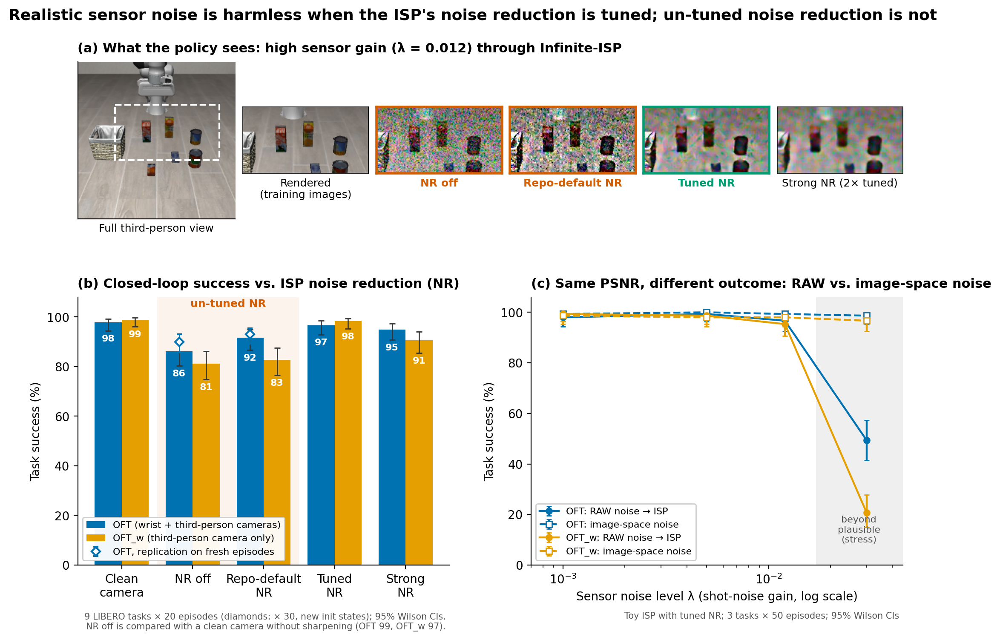
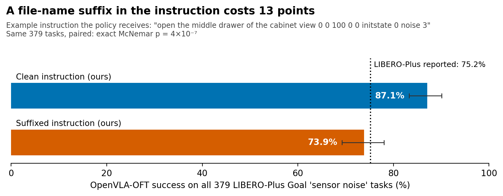

# Camera ISP Processing and Closed-Loop VLA Manipulation: A Reproduction of LIBERO-Plus and a Pre-Registered Probe

**Junhan Hu** · Technical report · October 2026
Code and per-episode data: <https://github.com/hujunhan/vla-isp-probe>

## Abstract

We evaluate OpenVLA-OFT, a 7B vision-language-action (VLA) policy, on the LIBERO simulation
benchmark. We use 4-bit quantization on a single 16 GB laptop GPU. The report makes three points.

**Reproduction.** We reproduce the Sensor Noise and Light columns of LIBERO-Plus Table 2 over all
2,743 tasks: 75.7% against 75.8% reported, and 91.3% against 88.7% reported.

**Benchmark properties.** In doing so we identify three properties of LIBERO-Plus that affect how
its results should be interpreted:
- its sensor-noise perturbation is applied only to the third-person camera;
- perturbed task instructions retain a file-name suffix, which lowers success on the Goal suite by
  13.2 percentage points (exact McNemar p = 4 × 10⁻⁷);
- its difficulty labels are inconsistent with its headline table.

**ISP probe.** We then ask whether simulated RAW sensor noise and the noise reduction of an image
signal processor (ISP) affect closed-loop success:
- With noise reduction tuned to the sensor gain, realistic noise has no measurable effect.
- Un-tuned noise reduction at high gain (disabled, or a fixed shipped default) reduces success by
  about 16 points for a policy that sees only the third-person camera.
- For a policy that also has a wrist camera, the reduction is about 8 points. That estimate declined
  across successive replications (29, 13, and 8 points).
- Image-space Gaussian noise matched in PSNR has no effect. Image-space robustness benchmarks would
  therefore not detect this sensitivity.

All results are from simulation. Predictions and decision rules were fixed before each experiment
was run.




**Figure 1.** Effect of ISP noise reduction on closed-loop success.

**(a)** One LIBERO render passed through our sensor model at high gain (λ = 0.012) and Infinite-ISP
with each noise-reduction preset. Crops are taken from the dashed region.

**(b)** Success by preset for both policies (E005: 9 tasks × 20 episodes). Diamonds show the OFT
replication on fresh initial states (E006: 9 tasks × 30 episodes). NR off is compared with a clean
camera without sharpening; the other presets with a clean camera with sharpening (§5.4).

**(c)** RAW-domain noise through the toy ISP with tuned noise reduction, compared with image-space
Gaussian noise at matched PSNR (E004: 3 tasks × 50 episodes). The shaded region lies beyond the
plausible noise range.

All error bars are Wilson 95% CIs. Generated by `scripts/make_figures.py`.

---

## 1. Introduction

VLA policies are trained and evaluated mostly on rendered or curated images. A deployed robot
instead sees images produced by an image sensor and an ISP, and parameters such as sensor gain and
noise reduction vary between cameras and operating conditions.

Robustness benchmarks such as LIBERO-Plus [1] model camera degradation as display-space
perturbations, such as blur and fog. This report examines that framing in two steps:
1. We reproduce part of the LIBERO-Plus robustness evaluation and audit how it is constructed.
2. We test, in closed loop, whether perturbations applied in the RAW domain and passed through an
   ISP change task success.

**Contributions.**
1. An independent reproduction of the OpenVLA-OFT row of LIBERO-Plus Table 2 (Sensor Noise and
   Light) on consumer hardware (§3).
2. Three findings about the construction of the LIBERO-Plus benchmark, and a failure mode in the
   evaluation harness (§4).
3. A RAW-domain camera simulation coupled to closed-loop LIBERO evaluation, with a toy ISP and an
   open-source ISP, Infinite-ISP [5] (§5.1–5.2).
4. Pre-registered experiments on spatial noise-reduction strength, including a replication and a
   confirmation on fresh episodes (§5.3–5.5).

## 2. Experimental Setup

### 2.1 Policies, benchmark, and software

| Item | Configuration |
|---|---|
| Policy "OFT" | OpenVLA-OFT [2], per-suite checkpoints `moojink/openvla-7b-oft-finetuned-libero-{spatial,object,goal,10}`. Inputs: third-person and wrist images |
| Policy "OFT_w" | `Sylvest/openvla-7b-oft-finetuned-libero-without-wrist` (per-suite subfolders). Input: third-person image only |
| Precision | 4-bit (bitsandbytes NF4). bf16 does not fit beside the EGL renderer in 16 GB: the weights load at 14.7 GiB, and the first forward pass runs out of memory. Quantized OpenVLA inference: [3], §3.5 and Table 2 |
| Benchmark | LIBERO-Plus [1], built on LIBERO [6], @ `4976dc3`; OpenVLA-OFT evaluation harness @ `e4287e9` |
| Software | Python 3.10.14, torch 2.2.0, transformers (OFT fork), mujoco 3.2.6, robosuite 1.4.1. Full pins: `scripts/setup_env.sh` |
| Hardware | One laptop: RTX 3080 Laptop 16 GB, 31 GB RAM, Ubuntu 24.04 |

**Feasibility at 4-bit precision.** OFT peaks at about 6.5 GB of GPU memory. Each model query takes
about 0.47 s, and a short successful episode takes about 7.5 s. A feasibility check on one easy task
gave 3/3 successes.

### 2.2 Statistical procedures

- **Success rates** are pooled over tasks, which weights each suite by its task count, and are
  reported with Wilson 95% confidence intervals.
- **Paired comparisons** on identical tasks use the exact McNemar test.
- **Harness exceptions** are recorded as errors and excluded from rates, not scored as policy
  failures (§4.4).
- **Drops** are given in percentage points as *reference − condition*, so a positive value means
  lower success under the condition.
- **Pre-registration.** For every experiment (E001–E006), predictions, success criteria, and
  decision rules were committed to a private lab notebook before the run. §7 reports outcomes
  against these predictions.

## 3. Reproduction of LIBERO-Plus Table 2

**Protocol.** We evaluated every Sensor Noise and Light task of LIBERO-Plus (2,743 tasks), with one
episode per task as in LIBERO-Plus, using the four per-suite OFT checkpoints.

The reported averages are weighted by task count. Pooling the paper's Table 10 suite values
reproduces its 75.78 and 88.69; unweighted suite means do not.

**Match rule (fixed before running).** Let SE denote the standard error of the difference,
combining both binomial estimates over the same n.

| Verdict | Condition |
|---|---|
| Match | \|difference\| ≤ 1.96 SE |
| Diverge | \|difference\| > 10 points |
| Ambiguous | otherwise |

**Table 1.** OpenVLA-OFT success (%) on LIBERO-Plus: ours (4-bit) against reported values.

| Suite | Noise, ours [95% CI] | Reported | Verdict | Light, ours [95% CI] | Reported | Verdict |
|---|---|---|---|---|---|---|
| Spatial | 94.6 [91.7, 96.5] | 96.3 | match | 100.0 [98.7, 100] | 98.3 | ambiguous (ceiling) |
| Object | 63.0 [58.3, 67.5] | 72.3 | ambiguous | 82.2 [77.4, 86.1] | 73.7 | ambiguous |
| Goal | 87.1 [83.3, 90.1] | 75.2 | **diverge** | 93.9 [90.5, 96.2] | 93.9 | match |
| Long | 63.3 [58.7, 67.6] | 63.5 | match | 89.4 [85.2, 92.5] | 89.4 | match |
| **Pooled (Table 2)** | **75.7** [73.5, 77.7] | **75.8** | **match** | **91.3** [89.6, 92.8] | **88.7** | ambiguous (+2.6 vs. ±2.5) |

Reported values are from [1], Table 10 (p. 31, per suite) and Table 2 (p. 9, pooled). Our data are
in `results/e002/`.

**Remarks.**
- **Unperturbed anchor.** On the unperturbed Spatial suite (10 tasks × 10 episodes) we obtain
  98/100, against 97.6 reported in [2] (Table I, p. 6).
- **Choice of target.** The figure of 97.1 ("Original") that is sometimes quoted alongside
  75.8/88.7 comes from LIBERO-Plus **Table 1** (p. 3). That table's Noise and Light values
  (76.7/85.8) differ from Table 2's. We target Table 2.
- **Deviations from the original setup:**
  - 4-bit instead of bf16 precision;
  - an RTX 3080 instead of an A100;
  - possibly different checkpoints. The checkpoint used for the paper's "OpenVLA-OFT" row is not
    stated exactly ([1], Table 6, p. 16, lists only `huggingface.co/moojink`), so we used the
    per-suite checkpoints.
- **Unresolved cells.** The two Object cells deviate in opposite directions, and we have not
  resolved them. A bf16 run would separate the effect of quantization from other causes.
- **The Goal/Noise divergence** is explained in §4.2.

## 4. Properties of the LIBERO-Plus Benchmark

### 4.1 Sensor noise is applied only to the third-person camera

LIBERO-Plus applies its camera perturbations in `libero/libero/envs/env_wrapper.py`
(`ControlEnv.step` and `reset`). They are applied to `agentview_image` only, and the wrist image is
never modified.

The sensor-noise codes map to perturbation families as follows:

| Codes | Family |
|---|---|
| 1–10 | motion blur |
| 11–20 | Gaussian blur |
| 21–30 | zoom blur |
| 31–40 | fog |
| 41–50 | glass blur |

Policies with a wrist camera therefore retain an unperturbed view. This is consistent with [1],
Table 10, where OFT without the wrist camera scores 49.9 on Noise, against 75.8 with it.

Within each family, success decreases with severity, but the shape differs between families:
- **Blurs** degrade gradually. For example, motion blur falls from about 96% at severity 1 to 45% at
  severity 10 (pooled).
- **Fog** has little effect up to severity 8, then falls to 41–62%.

Per-family and per-severity tables are in `results/e002/final_summary.md`.

### 4.2 Perturbed instructions retain a file-name suffix

LIBERO-Plus derives each task's instruction from its file name (`grab_language_from_filename` in
`libero/libero/benchmark/__init__.py`). Perturbed tasks therefore receive instructions such as
"…place it on the plate **view 0 0 100 0 0 initstate 0 noise 3**" or "…**light 1**". The OFT
harness passes this text to the policy unchanged.

We evaluated all 379 Goal-suite Sensor Noise tasks under both instruction forms. Table 2 and Figure 2 give
the results.

**Table 2.** Goal-suite Sensor Noise success by instruction form.

| Instruction | Success |
|---|---|
| Clean (suffix removed; verified identical to the original LIBERO instruction) | 87.1% |
| Suffixed (as generated by LIBERO-Plus) | 73.9% |
| Reported in [1] | 75.2% |



**Figure 2.** OpenVLA-OFT success on the 379 Goal-suite Sensor Noise tasks, with the clean
instruction and with the instruction as generated by LIBERO-Plus. Error bars are Wilson 95% CIs.
The dotted line marks the value reported in [1].

Across the same 379 tasks:
- 74 tasks succeed only with the clean instruction and 24 only with the suffixed one (exact McNemar
  p = 4 × 10⁻⁷).
- Re-running 30 tasks changed 0 of 30 outcomes, so the asymmetry reflects the instruction rather
  than run-to-run variation.

The effect does not appear everywhere. The shorter Light suffix had no detectable effect on Goal
(29/30 vs. 30/30 on 30 paired tasks), and the Noise suffix had none on Spatial (27/30 vs. 27/30).

With the suffix, our Goal Noise result agrees with the reported value. Without it, it diverges by
+11.9 points. This is strong circumstantial evidence that the published cell was measured with the
suffixed instruction, although we have not confirmed this in the authors' code.

If so, roughly half of the reported 25-point "sensor noise" drop on Goal reflects corrupted
language rather than degraded images. Data: `results/e003/`.

### 4.3 The difficulty labels are inconsistent with Table 2

LIBERO-Plus App. C.3 (p. 18) defines difficulty level L5 as tasks "solved by none" of four models,
OpenVLA-OFT among them.

In the released `task_classification.json`, 227 of 1,142 Light tasks (19.9%) are labelled L5. By
that definition, OpenVLA-OFT's Light success could not exceed 80.1%, yet Table 2 reports 88.7%. Our
per-level results also disagree with the definition at the extremes (Table 3).

**Table 3.** Our OFT success by LIBERO-Plus difficulty level.

| Level | Ours, Noise | Ours, Light | OFT, by definition |
|---|---|---|---|
| L1 | 92% | 95% | 100% |
| L5 | 32% | 75% | 0% |

The levels therefore cannot derive from the same OpenVLA-OFT evaluation as Table 2, and they should
not be read as a severity scale. Where a severity axis is needed, we recommend the noise code within
each family (§4.1).

### 4.4 Evaluation harness: exceptions are scored as failures

In the OpenVLA-OFT harness (`run_libero_eval.py`), `run_episode` catches every exception and
records the episode as a policy failure. In our runs, out-of-memory errors initially appeared as 0%
success. Our wrappers record such errors separately and abort a run after three consecutive errors.

Unpinned dependency installation also failed in five places:
- numpy 2.2;
- tensorflow-metadata 1.21 with protobuf;
- wandb 0.28;
- mujoco 3.14, which triggers a joint-type assertion in robosuite 1.4.1;
- accelerate 1.15 combined with bitsandbytes.

Working pins are listed in `scripts/setup_env.sh`.

## 5. Probe: Does Simulated RAW Processing Affect Closed-Loop Success?

### 5.1 Camera simulation

Each rendered observation passes through the following pipeline before reaching the policy:

```
MuJoCo render (8-bit)
  → unprocess: inverse tone curve → inverse gamma → inverse CCM → inverse WB/gain → RGGB mosaic
  → sensor: shot + read noise (variance = x·λ_shot + λ_read), 12-bit quantization
  → ISP → policy
```

**RAW synthesis.** We use the unprocessing method of Brooks et al. [4] (§3–4), with camera
parameters fixed at the centre of their sampling ranges:
- the mean of their four colour matrices;
- red gain 2.15 and blue gain 1.7 (§3.4, p. 4);
- brightness gain 1/0.8.

**Noise levels.** We treat λ_shot ∈ [1e-4, 1.2e-2] as the plausible range ([4], §3.1, p. 4), with
read noise taken from their fitted log-log relation. Higher levels are labelled "stress".

**Renderer.** MuJoCo 3.2.6 renders with fixed-function lighting and without gamma
(`src/render/render_gl*.c`), so we treat the render as display-referred camera output. A variant
that treats the render as linear produced no change at the tested noise levels.

### 5.2 Image signal processors

**Toy ISP** (`isp/camera.py`).
- Stages: edge-aware demosaicing, chroma-median false-colour suppression, then colour non-local
  means (NLM) denoising.
- Presets: *tuned* uses the PSNR-optimal NLM strength for each noise level; *strong* uses twice
  that strength.

**Infinite-ISP** [5] (10x-Engineers, Apache-2.0, @ `3221207`; adapter in `isp/infinite.py`).
- Stages, all from the upstream implementation: Bayer joint-bilateral noise reduction,
  Malvar-He-Cutler demosaicing, unsharp-mask sharpening, and luma-only NLM.
- Presets:

  | Preset | Setting |
  |---|---|
  | off | no noise reduction and no sharpening |
  | repo default | the shipped configuration |
  | tuned | PSNR-optimal against the ISP's own noise-free output |
  | strong | twice the tuned strengths |

- White balance, colour matrix, and tone curve are fixed to match our unprocessing, so that a
  noiseless frame reproduces the render. Auto-exposure, auto white balance, and saturation
  enhancement are disabled.

### 5.3 Controls, policies, and decision rule

**Controls.**
- The **clean camera** applies the RAW round trip without noise. It had no effect on either policy
  relative to the raw render.
- **Image-space Gaussian noise** is matched in PSNR to each RAW condition.

**Policies.** OFT (wrist and third-person cameras) and OFT_w (third-person camera only), both at
4-bit precision with clean instructions.

**Replication rule (pre-registered).** A preset has an effect on a policy if both of the following
hold:
1. the pooled drop is at least 10 points, with non-overlapping Wilson 95% CIs;
2. the drop is at least 10 points in at least 2 of the 3 suites.

The effect replicates if this holds for both policies.

### 5.4 Results

Figure 1 summarizes the main results. Tables 4–6 give the full values.

**Table 4.** Toy ISP, 3 tasks × 50 episodes (E004). Drops in points, relative to the clean camera
(98.7% for both policies).

| Condition | OFT | OFT_w |
|---|---|---|
| Plausible noise (λ 1e-4 … 1.2e-2), tuned NR | ≤ 2.0 | ≤ 3.3 |
| +1 EV over-exposure | none | 0.7 |
| λ 1.2e-2, NR off | 29.3 | 6.7 |
| λ 1.2e-2, NR strong | 26.7 | 40.7 |
| Stress, λ 3e-2 / 6e-2 | 49 / 71 | 78 / 96 |
| Image-space noise at matched PSNR (up to stress λ 3e-2) | none (≤ 0) | ≤ 2.0 |

**Table 5.** Infinite-ISP, 9 tasks (3 per suite) × 20 episodes, λ = 0.012 (E005). Drops in points,
relative to the matching clean frame. Suite drops are listed as Spatial / Object / Goal.

| Preset | OFT | OFT suite drops | OFT_w | OFT_w suite drops |
|---|---|---|---|---|
| NR off | **13.3** | 0 / 30 / 10 | **16.1** | 33 / 2 / 13 |
| Repo default | 6.1 | 2 / 15 / 2 | **16.1** | 25 / 7 / 17 |
| Tuned | 1.1 | 0 / −2 / 5 | 0.6 | 2 / 0 / 0 |
| Strong | 2.8 | 0 / 8 / 0 | 8.3 | 18 / 3 / 3 |

Bold marks presets that meet the replication rule.

**Table 6.** OFT confirmation on fresh initial states, 9 tasks × 30 episodes (E006). Drops in
points.

| Preset | Pooled drop | Spatial / Object / Goal |
|---|---|---|
| NR off | 7.8 (CIs separate) | −1 / 16 / 9 |
| Repo default | 5.9 (CIs separate) | 0 / 13 / 4 |

**Outcome of the replication rule.**
- **E005 replicated.** OFT met the rule through NR off, borderline, with one suite exactly at the
  10-point threshold. OFT_w met it through both NR off and the repo default.
- **E006 did not confirm OFT** on fresh episodes: the pooled drop fell below 10 points, and only one
  suite exceeded the threshold.
- **Net:** the effect is established for OFT_w only.

### 5.5 Discussion

1. **Realistic sensor noise is harmless when noise reduction is tuned to the gain.** This holds for
   both ISPs and both policies.
2. **Un-tuned noise reduction at high gain degrades performance.**
   - For OFT_w the drop is about 16 points and is spread across suites.
   - For OFT it is about 8 points and is concentrated in the texture-dependent Object tasks. This
     estimate declined with each replication: 29 points with the toy ISP, 13 with Infinite-ISP, and
     8 on fresh episodes. We regard the latest estimate as the most reliable.
3. **The way noise reduction fails matters.** Over-smoothing with the toy ISP's colour NLM degrades
   OFT_w broadly (a 33-point drop on 9 tasks, in all three suites). Infinite-ISP's luma-only strong
   preset costs only 8 points. Chroma smoothing is one plausible explanation of the difference, but
   we have not tested it.
4. **Image-space noise does not predict RAW-domain sensitivity.** At matched PSNR, image-space noise
   leaves success at or above 96.7%, even where RAW-domain stress noise reduces it to 21–49%.
   Fine-grained noise is tolerated; the loss of texture after a realistic pipeline is not.

## 6. Limitations

- **One ISP parameter.** Only spatial noise-reduction strength was varied, and for Infinite-ISP only
  at a single gain level. Untested stages:
  - temporal noise reduction;
  - auto-exposure and auto-white-balance dynamics;
  - exposure time and motion blur;
  - tone mapping and HDR;
  - sharpening in isolation;
  - compression;
  - lens effects;
  - rolling shutter.

  Several of these interact with motion and may matter more in closed loop.
- **Approximate RAW.** The RAW is synthesized from 8-bit renders, without true dynamic range or a
  spectral model, and with fixed camera parameters.
- **Quantized models.** All evaluations use 4-bit models, because bf16 could not be run on this
  hardware.
- **Small samples.** The probe covers 3 tasks (toy ISP) or 9 tasks (Infinite-ISP). With 20–30
  episodes per task, per-suite CIs are about ±10 points.
- **A single open ISP.** Infinite-ISP's presets do not represent the tuning of any real camera.
- **Simulation only.** No real camera or physical robot was used.

## 7. Pre-Registered Predictions and Outcomes

Predictions were fixed before each run, and roughly half did not hold. The notable misses:

| Topic | Prediction | Outcome |
|---|---|---|
| Reproduction, Object suite | 65–80 | 63.0 (Noise), 82.2 (Light) |
| Reproduction, Goal Noise | 68–82 | 87.1 (later explained by §4.2) |
| Reproduction, largest divergence | Long suite | Long matched best |
| Noise families | fog and glass blur hurt most | zoom and Gaussian blur hurt most |
| Instruction suffix | costs ≤ 5 points | costs 13 points on Goal |
| ISP probe, plausible noise | costs 5–30 points | costs ≤ 3.3 points |
| ISP probe, RAW vs. image-space noise at matched PSNR | RAW noise hurts less | no difference at plausible levels; RAW noise hurts far more at stress levels |
| Run-to-run variation | 3–6 of 30 outcomes change | none changed |

## 8. Reproducibility

The repository README describes three levels of reproduction:
- **Tier 0:** recompute every table in this report from the per-episode CSVs in `results/` (CPU
  only, about one minute).
- **Tier 1:** run the camera simulation in isolation.
- **Tier 2:** re-run the closed-loop experiments. The README gives the upstream commits, environment
  pins, exact commands, and our wall-clock time for each experiment.

## 9. Attribution

| | |
|---|---|
| **Adopted** | LIBERO-Plus benchmark and assets; OpenVLA-OFT harness and checkpoints; Infinite-ISP modules; the original LIBERO task list (MIT, vendored in `scripts/libero_original_task_map.py`) |
| **Adapted** | Brooks et al. unprocessing (fixed parameters, with a forward ISP made round-trip consistent); OpenVLA-OFT harness wrappers (original-task suites, category selection, instruction cleaning, error accounting, observation-level camera model) |
| **Authored** | Experiment design and pre-registered decision rules; the camera/ISP probe (sensor model, toy ISP, Infinite-ISP integration and calibration); the benchmark analyses in §4 |

The code was drafted with an AI coding assistant under the author's direction. Commits tagged
`[ai-scaffold]` in the source history mark the drafted code.

## References

1. S. Fei et al. *LIBERO-Plus: In-depth Robustness Analysis of Vision-Language-Action Models.*
   arXiv:2510.13626. Cited: Table 1 (p. 3), Table 2 (p. 9), Table 6 (p. 16), App. C.3 (p. 18),
   Table 10 (p. 31).
2. M. J. Kim et al. *Fine-Tuning Vision-Language-Action Models: Optimizing Speed and Success*
   (OpenVLA-OFT). arXiv:2502.19645. Cited: Table I (p. 6).
3. M. J. Kim et al. *OpenVLA.* arXiv:2406.09246. Cited: §3.5 (p. 6), Table 2 (p. 10, quantized
   inference memory).
4. T. Brooks et al. *Unprocessing Images for Learned Raw Denoising.* CVPR 2019, arXiv:1811.11127.
   Cited: §3.1–3.4 (p. 4), §4 (p. 5). Reference code: google-research/unprocessing (Apache-2.0).
5. 10x-Engineers. *Infinite-ISP.* <https://github.com/10x-Engineers/Infinite-ISP> @ `3221207`
   (Apache-2.0).
6. B. Liu et al. *LIBERO.* NeurIPS 2023 Datasets and Benchmarks Track.
