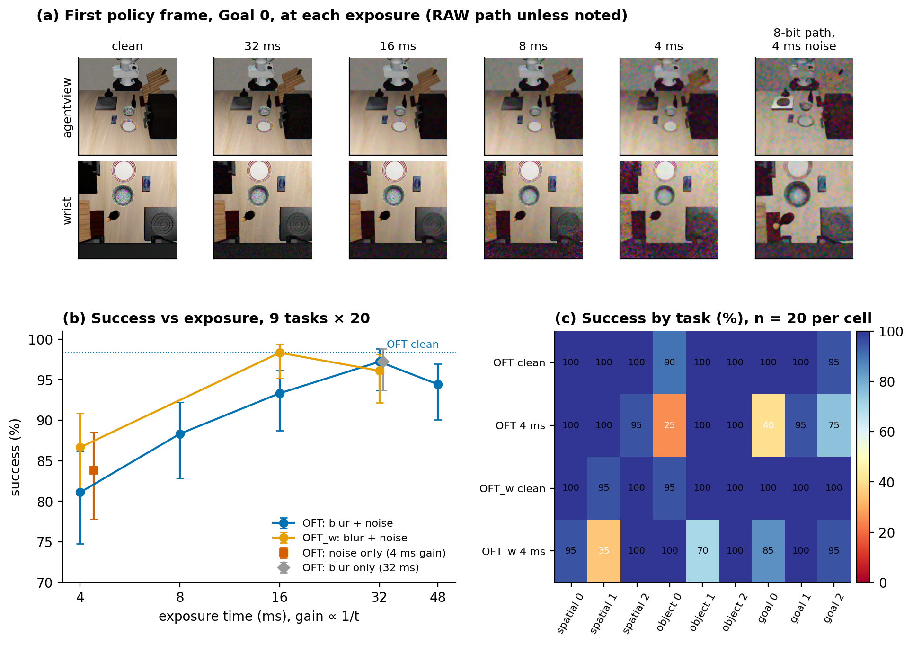
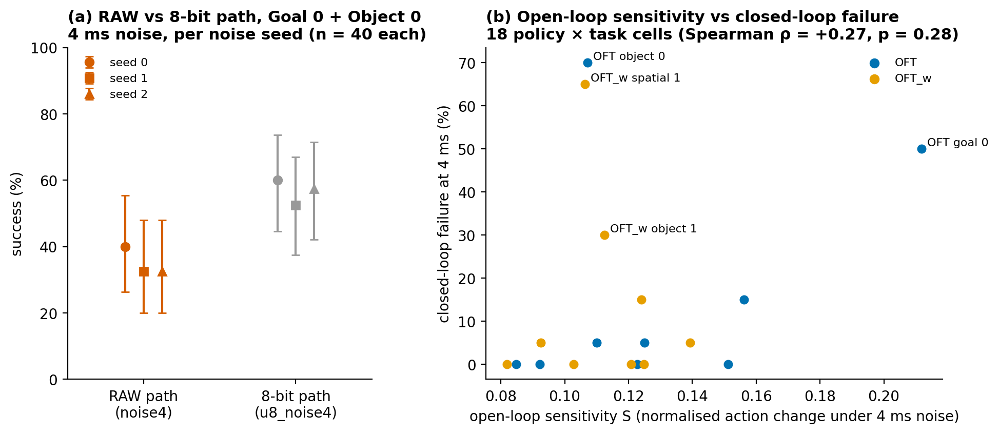

# Exposure Time, Motion Blur and Sensor Noise in Closed-Loop VLA Manipulation: A Pre-Registered Simulation Study

**Junhan Hu** · Technical report · October 2026
Code and per-episode data: <https://github.com/hujunhan/vla-isp-probe> · Companion to [REPORT.md](REPORT.md)

## Abstract

A camera's exposure time couples two degradations. A short exposure needs more gain and so has more
noise; a long exposure integrates the robot's own motion and so blurs. Robustness benchmarks for
vision-language-action (VLA) policies apply blur and noise as separate image-space corruptions, so this
trade-off has not been measured for policies. We simulate it physically in LIBERO:
- each policy frame integrates 2 ms physics sub-steps over the exposure window, rendered in linear HDR;
- the integrated frame passes through a RAW sensor model with shot and read noise at the gain that holds
  brightness constant;
- an open-source ISP processes it, with noise reduction tuned to each exposure.

We evaluate OpenVLA-OFT (4-bit) closed-loop on 9 tasks at a fixed scene light level, with predictions and
decision rules fixed before each run.

- **The trade-off is all noise.** Success falls monotonically as exposure shortens: 98.3% clean, 97.2%
  at 32 ms, 81.1% at 4 ms. Noise alone reproduces the 4 ms loss (83.9%). Blur alone at 32 ms costs
  nothing measurable (97.2%), although 32 ms blurs the wrist image by 2–4 px in most frames. There is no
  interior optimum.
- **The loss is concentrated, and its location depends on the policy.** The same images break two tasks
  for OFT and two different tasks for a variant without the wrist camera. An open-loop measure of how
  much the policy's actions change under noise does not predict which tasks break (Spearman ρ = 0.27).
- **The simulation route changes the size of the effect, not its direction.** A cheaper route
  "unprocesses" LIBERO's native 8-bit render. At matched noise parameters it finds the same direction and
  the same fragile tasks.
  On those tasks, though, the physical RAW route loses 21.7 points more (95% CI [7.5, 35.8]; replicated
  across three noise seeds). At equal mid-grey variance, the share of read versus shot noise changes the
  result by a similar amount.

All results are from simulation, for one policy family and one light level.

**Figure 3.**
- **(a)** The first policy frame of LIBERO-Goal task 0 (init state 20) at each exposure, from the RAW
  route. The last column is the 8-bit route at the 4 ms noise parameters. That route starts from LIBERO's
  native renderer, so its clean scene looks slightly different (§3.4). Images are 256 px. At the first
  frame the robot is still, so these frames show noise only.
- **(b)** Closed-loop success against exposure time (9 tasks × 20 episodes per point, Wilson 95% CIs).
  "Noise only" uses the 4 ms gain without sub-frame integration. "Blur only" integrates 32 ms of
  sub-frames without noise.
- **(c)** Success by task at 4 ms for both policies (n = 20 per cell).

Generated by `scripts/make_figures_c1.py`.

---

## 1. Introduction

The companion report ([REPORT.md](REPORT.md) §5) found that ISP noise reduction tuned to the sensor gain
removes the effect of realistic sensor noise on OpenVLA-OFT. That study held the camera's timing fixed.
In a real camera, gain is not free: at a fixed light level, raising gain is how a camera shortens its
exposure, and a longer exposure is how it avoids gain. The choice of exposure time therefore trades noise
against motion blur. Because the robot carries the wrist camera and moves the objects it looks at, the
blur depends on the policy's own actions.

Existing VLA robustness benchmarks model motion blur as a fixed image-space kernel, independent of the
motion: LIBERO-Plus [1], RobustVLA [7] and [8]. Noise is applied as a separate corruption. Several
recent works are close in spirit:
- **RawVLA** [9], concurrent with our companion report, sweeps RAW-domain ISP parameters, including
  exposure and sensor noise, one at a time on LIBERO. Its noise axis is independent of illumination, so
  exposure and noise are not coupled, and its limitations list motion blur as future work.
- **E-VLA** [10] states the low-light exposure trade-off and evaluates real long-exposure blur. It
  addresses the problem with an event camera.
- **DiffPhysCam** [11] simulates exposure-window motion blur and Poisson–Gaussian noise for embodied AI,
  but does not measure policy success under them.
- **Elmquist et al.** [12] ablate camera-model components for a perception algorithm's sim-to-real gap.

We found no study that varies exposure time with physically coupled blur and noise and measures
closed-loop policy success. Our search was not exhaustive.

**Contributions.**
1. A physically coupled exposure model for LIBERO: sub-frame time integration of HDR renders, followed
   by a RAW sensor model and gain-matched noise.
2. A pre-registered decomposition of the exposure effect into blur and noise, for two policy variants.
3. A controlled comparison of the physical RAW route against the common 8-bit unprocessing route, and of
   the noise composition.
4. An open-loop probe testing whether per-task fragility is visible in action sensitivity.

## 2. Method

### 2.1 Rendering and time integration

- **Renderer.** LIBERO's native OpenGL renderer outputs 8-bit display images. We render the same
  simulator states with MuJoCo's Filament renderer, extended to read back a linear RGBA16F target
  (`hujunhan/mujoco@8f82efa`, branch `filament-rgba16f`).
- **Matching.** We matched Filament's lighting, materials and pixel integration to the native renderer
  (`e008/filament_match.py`). With those settings, OFT succeeds on 98.3% of 60 episodes on Filament
  renders against 100% natively. Filament as shipped scores 78.3% (`results/e008/`).
- **Exposure.** robosuite runs 25 physics sub-steps of 2 ms per 20 Hz control step. For exposure t, the
  K = t / 2 ms sub-step states ending at the observation are each rendered in HDR and averaged in linear
  light. This models a global shutter.
- **Query frames only.** OFT queries the model once per 8-action chunk, so only query frames pass through
  the camera chain (`e009/c1.py`).
- **How much blur.** A logging run (`e007/`, 45 episodes) measured image motion from the simulator
  state with rigid-body flow. At 32 ms the 95th-percentile blur is 4.4 px on the wrist camera and 2.5 px
  at the agent-view end-effector, at 256 px.

### 2.2 RAW formation and noise

- **Electrons.** The linear render is converted to scene radiance. Electrons per channel follow ISETCam's
  method [13]: a display-primary spectral model, a public colour-filter QE curve shipped with ISETCam,
  an IR filter and cos⁴ lens shading, with an RGGB mosaic.
- **Pixel.** ISETCam's default pixel: 10 e⁻ rms read noise and a 10,000 e⁻ full well. Output is 12-bit
  with a black level of 256 (`isp/raw_formation.py`).
- **Brightness.** The output level is matched to the native render once per camera and task, at
  frame 0.
- **Gain and exposure.**
  - At exposure t, the sensor collects 1 / G(t) of the output-referred electrons. The gain G(t) is
    proportional to 1 / t and restores brightness: G = 40.6, 20.3, 10.1, 5.07 and 3.38 at 4, 8, 16, 32
    and 48 ms.
  - Shot noise is Poisson on the collected electrons; read noise is Gaussian.
  - Without noise, the RAW is bit-identical at every gain (`tests/test_raw_formation.py`). So **exposure
    changes only noise (through G) and blur (through K)**.
- **Light level.** At 4 ms, the total noise variance at 18% of full scale equals that of the companion
  report's high-gain level (λ = 0.012; 2.38 × 10⁻³). At that level the companion report found tuned noise
  reduction sufficient. Here, 4 ms is read-noise-dominated: the full scale is 246.5 e⁻.

### 2.3 ISP

- **ISP.** Infinite-ISP [5] stages, from black-level correction to gamma, as in the companion report.
  Sharpening is off in every condition.
- **Noise reduction.** Bayer NR and non-local means are set per exposure to maximise PSNR against the
  noise-free chain. Tuning uses held-out frames (init state 45), over the same grid as the companion
  report (`e009/calibrate_nr.py`, `results/e009/nr_calibration.json`).

### 2.4 Policies, tasks and statistics

- **Policies.**
  - **OFT:** OpenVLA-OFT [2], LIBERO checkpoints, 4-bit, agent-view plus wrist images.
  - **OFT_w:** the same with the agent-view image only.
- **Tasks.** Tasks 0–2 of LIBERO-Spatial, -Object and -Goal [6]. Each condition runs 20 episodes per
  task on init states 20–39.
  - These states are disjoint from the companion report's Infinite-ISP runs (0–19) and from the
    NR-tuning state (45).
  - The companion report's OFT confirmation run also used states 20–49.
- **Determinism.** The simulator and policy are deterministic per init state. Camera noise is seeded per
  (seed, task, episode, camera).
- **Statistics.**
  - Rates carry Wilson 95% CIs.
  - Condition-vs-clean contrasts use a one-sided Fisher exact test, as pre-registered.
  - The multi-seed comparison (§3.4) is paired by init state: a two-sided sign-flip permutation test
    (10⁵ flips) with a bootstrap CI.
- **Pre-registration.** Predictions and decision rules for each stage were written in a private lab
  notebook before the stage ran. The rules are restated in the analysis script docstrings. §5 lists the
  predictions, including the misses.

## 3. Results

### 3.1 Success falls monotonically as exposure shortens

**Table 1.** OFT, 9 tasks × 20 episodes per row (`results/e009/oft.csv`, `e009/aggregate_e009.py`).

| Condition | Blur (sub-frames) | Gain | Success [95% CI] | Drop | p (one-sided) |
|---|---|---|---|---|---|
| clean | 1 | — | 98.3 [95.2, 99.4] | — | — |
| 4 ms | 2 | 40.6 | 81.1 [74.8, 86.2] | 17.2 | 1.5 × 10⁻⁸ |
| 8 ms | 4 | 20.3 | 88.3 [82.8, 92.2] | 10.0 | 8.7 × 10⁻⁵ |
| 16 ms | 8 | 10.1 | 93.3 [88.7, 96.1] | 5.0 | 0.016 |
| 32 ms | 16 | 5.07 | 97.2 [93.7, 98.8] | 1.1 | 0.36 |
| 48 ms | 24 | 3.38 | 94.4 [90.1, 97.0] | 3.9 | 0.043 |

- **Holds with tuned NR.** The drop occurs even with noise reduction tuned to each exposure. Failures are
  all timeouts, and noisy episodes are slower: 143 policy steps on average at 4 ms against 112 clean.
- **Effect size.** The pre-registered rule (a drop of ≥ 10 points with p < 0.05) flags 4 and 8 ms.
- **Optimum.** The best exposure is the longest that keeps blur harmless: 32 ms here. There is no
  interior optimum.
- **48 ms.** The dip at 48 ms is below the 5-point threshold. It sits on one task: Goal 0, 15/20 against
  19/20 at 32 ms (p = 0.18).

### 3.2 The exposure effect is noise, not blur

**Table 2.** Decomposition (OFT, n = 180 each).

| Arm | Construction | Success | Drop |
|---|---|---|---|
| noise only | 4 ms gain, 1 sub-frame | 83.9 | 14.4 |
| blur only | 16 sub-frames (32 ms), no noise | 97.2 | 1.1 (p = 0.36) |
| image-space blur | instantaneous render, linear kernel of the mean 32 ms blur length, random angle | 96.7 | 1.7 |

- **Noise.** Noise alone accounts for the 4 ms loss: 83.9% against 81.1% with blur. Blur adds at most
  about 3 points.
- **Blur.** At LIBERO's speeds, blur at 32 ms has no measurable effect.
- **Physical vs image-space blur.** The two do not differ (−0.6 points). Neither hurts, so this test
  cannot tell whether image-space blur is a valid proxy where blur does matter.
- **Black-level clipping.** Black-level subtraction clips negative read noise and lifts dark regions.
  Keeping the RAW signed through Bayer NR does not help (80.6%, −3.3 against noise4), so that
  rectification is not the cause.

### 3.3 Fragile tasks depend on the policy and are not predicted by open-loop sensitivity

**Table 3.** Successes out of 20 at 4 ms (Figure 3c). Every other task is 17–20 for both policies.

| Task | OFT | OFT_w |
|---|---|---|
| Goal 0 (open the middle drawer) | **8** | 17 |
| Object 0 | **5** | 20 |
| Spatial 1 | 20 | **7** |
| Object 1 | 20 | **14** |

- **Same images, different tasks.** Both policies receive the same images on these tasks, yet they fail on
  different ones.
- **Overall drop.** OFT_w's overall 4 ms drop (12.2 points) is not larger than OFT's (17.2; p = 0.20).
- **Pattern predates this study.** The same per-task pattern appears in the companion report's Infinite-ISP
  runs, which used a different noise model, image route and init states (`results/e005/`), for OFT on
  Goal 0 and Object 0 and for OFT_w on Spatial 1.

**Open-loop probe** (`e010/`, Figure 4b).
- **Design.**
  - Both policies run clean episodes on all 9 tasks, init states 20–24: 90 episodes.
  - At every query, the same instantaneous render also passes through the 4 ms noise and NR chain 8
    times. The policy is queried on each version, and the actions are recorded but not executed.
  - Sensitivity S is the mean absolute change in the translation actions, normalised by their clean
    standard deviation.
  - A repeated clean query reproduces the clean action exactly.
- **Rule (pre-registered).** S explains fragility if Spearman ρ(S, closed-loop failure rate) ≥ 0.5 with
  p < 0.05 over the 18 policy–task cells, and at least 3 of 4 pre-specified cross-policy comparisons hold.
- **Result.** ρ = 0.27 (p = 0.28), and 2 of 4 comparisons hold, so the hypothesis is not supported. OFT's
  most fragile task (Object 0, 70% failure) has below-average S, and a lower S than OFT_w on the same
  task, where OFT_w never fails.
- **Exception.** OFT on Goal 0 has the largest S, rotation sensitivity and 90th-percentile S of any
  cell, so its loss may be direct action jitter.
- **Not supported either.** Gripper sign-flip rate and sensitivity near grasp do not predict fragility.
- **Clean failures.** The only failures in the clean probe episodes fall on fragile cells (OFT Object 0,
  2 of 5; OFT_w Spatial 1, 1 of 5). This suggests that low closed-loop margin, rather than image
  sensitivity, makes a task fragile. We did not test it.

**Figure 4.**
- **(a)** Success on the two fragile OFT tasks at 4 ms noise, physical RAW route against 8-bit route,
  for each of three independent noise seeds (n = 40 per point, same init states).
- **(b)** Open-loop sensitivity against closed-loop failure rate at 4 ms, one point per policy × task.

### 3.4 Route and noise model: same direction, different size

**The 8-bit route.**
- **How it works.** Many simulation studies, including our companion report and RawVLA [9], derive RAW
  by "unprocessing" an 8-bit render [4]. We ran that route with the 4 ms noise parameters and the same
  ISP. The NR preset was tuned the same way and came out identical.
- **Results.**
  - Clean, it matches the RAW route: 97.8% against 98.3%.
  - With noise it loses 8.4 points (89.4%, p = 0.002), against 14.4 for the RAW route.
  - It loses them on the same two tasks: Goal 0 13/20 against 10/20, Object 0 11/20 against 6/20.
- **Is the difference real?** At n = 180 the difference was unresolved (+5.6, p = 0.16). A pre-registered
  follow-up re-ran the two fragile tasks with two new noise seeds on the same init states. Over 40
  (task, init state) units × 3 seeds, the 8-bit route succeeds 21.7 points more often (95% CI [7.5, 35.8],
  permutation p = 0.0065). Each seed separately gives +20, +20 and +25 (Figure 4a).
- **Over all 9 tasks** the routes differ by about 5 points.
- **Cause.** We have not identified it. Two things differ between the routes:
  - **The starting image.** The 8-bit route starts from LIBERO's native 8-bit render. The RAW route
    starts from the matched linear Filament render.
  - **Dark regions.** At the same noise parameters the outputs look clearly different in dark regions.
    The RAW route lifts them into a washed-out grey; the 8-bit route keeps them dark with chroma noise
    (Figure 3a, last two columns).

  The clean versions of both routes give the same success, so neither starting image is easier on its
  own. Rectification before noise reduction is ruled out (§3.2). Clipping after it, in white balance,
  demosaicing and colour correction, is untested.

**Noise composition.**
- **Setup.** On the 8-bit route, we compared noise with the same total variance at mid-grey but the
  companion report's shot-dominated composition.
- **Result.** It costs 1.7 points (96.1%), against 8.4 for the read-dominated 4 ms noise (difference 6.7,
  p = 0.012).
- **Decomposition.** A descriptive split of the 13.3-point gap between the companion report's tuned-NR
  result (−1.1) and this study's (−14.4): about 6.7 points come from noise composition and 5.6 from the
  route.

## 4. Discussion and limitations

- **What the results support (simulation).**
  - When the light level makes short exposures read-noise-limited, OFT degrades monotonically as exposure
    shortens, even with tuned NR.
  - Motion blur up to 32 ms does not matter at LIBERO speeds.
  - For choosing an exposure on this benchmark, the answer is "as long as blur stays harmless", and the
    noise side decides it.
- **Evaluation-method implications.**
  - Results from the 8-bit unprocessing route have the right sign, but they can understate losses on the
    tasks that matter by a factor of about 2. "Route" here includes the starting render, native 8-bit
    or matched linear HDR, and we have not separated the two.
  - The assumed noise composition matters as much as the route. A noise level stated as one variance
    number is not enough to reproduce a result.
- **Limitations.**
  - **One light level.** A darker scene would push the noise crossover to longer exposures, where blur is
    larger. Whether a blur-noise optimum then appears is the natural next experiment.
  - **Slow motion.** LIBERO motion is slow, and the policy's 224 px input may hide 2 px of blur. Faster or
    dynamic tasks may change the blur result.
  - **Unvalidated camera model.** It has no optical PSF, dark current, fixed-pattern noise, rolling
    shutter or compression, and has not been compared with a real camera.
  - **One policy family.** Two variants of OpenVLA-OFT, 4-bit only.
  - **Concentrated, post-hoc effect.** The effect sits on two tasks per policy, identified after the
    first stage. The follow-up replicates on new noise draws but not on new init states.
  - **Correlated episodes.** Per-task cells are small (n = 20). Episodes that share an init state are
    correlated; only §3.4's follow-up accounts for this.

## 5. Pre-registered predictions and outcomes

The author's advisor wrote these predictions before each stage. Full tables are in the notebook.

| Stage | Prediction | Outcome |
|---|---|---|
| Exposure sweep | Flat: tuned NR keeps 4 ms within 3 points; P(drop ≥ 10) ≈ 0.25 | **Miss**: −17.2. Extrapolated from the companion report's shot-dominated noise, which §3.4 shows is the gentle case |
| Decomposition | Noise only within 5 of the 4 ms chain; blur only drops ≤ 3 | Hit; hit |
| OFT_w | Larger 4 ms drop than OFT (20–35 points) | **Miss**, wrong direction (12.2) |
| Rectification | Signed RAW recovers 1–8 points | **Miss** (−3.3) |
| 8-bit route | Within 5 points of the RAW route (P ≈ 0.55) | 5.6 apart; on fragile tasks 21.7 |
| Multi-seed follow-up | Regression to the mean: difference +5 to +15 | **Miss**: +21.7, no regression |
| Open-loop probe | ρ 0.3–0.5, P(supported) ≈ 0.35; 3 of 4 cross comparisons; sensitivity peaks at grasp | ρ 0.27, 2 of 4, lower at grasp: not supported |

## 6. Reproducibility

The README's "C1" section gives the commands.
- **Tier 0.** Every table and figure here is recomputed from the per-episode CSVs and summaries in
  `results/e007`–`e010` on a CPU.
- **Tier 2.** Closed-loop re-runs need:
  - a source build of MuJoCo from the fork above, in a separate `mjhdr` environment, which hosts the
    render server;
  - an ISETCam clone (`ISETCAM_ROOT`);
  - Infinite-ISP at the commit used by the companion report.

We used one RTX 3080 Laptop GPU. Closed-loop episodes take 13–21 s on the RAW route and 26–50 s on the 8-bit route, which processes every frame. Probe episodes take 110–180 s.

## 7. Attribution

| | |
|---|---|
| **Adopted** | LIBERO tasks and assets; robosuite and MuJoCo; OpenVLA-OFT harness and checkpoints; MuJoCo's Filament renderer; Infinite-ISP modules; ISETCam data (display primaries, QE and IR curves, default pixel parameters) |
| **Adapted** | Filament renderer: RGBA16F HDR read-back (our fork) and lighting/material matching. ISETCam's radiance-to-electron method, re-implemented in Python. Infinite-ISP: a signed-input variant and per-exposure NR calibration. Brooks et al. unprocessing with this study's noise parameters |
| **Authored** | Experiment design and pre-registered rules; sub-frame time integration; the gain-coupled noise model; the image-motion measurement; the open-loop probe and all analyses |

The code was drafted with an AI coding assistant under the author's direction; commits tagged
`[ai-scaffold]` in the source history mark drafted code. No data, code or parameters from any camera or
sensor vendor's non-public sources were used.

## References

1. S. Fei et al. *LIBERO-Plus: In-depth Robustness Analysis of Vision-Language-Action Models.*
   arXiv:2510.13626.
2. M. J. Kim et al. *Fine-Tuning Vision-Language-Action Models: Optimizing Speed and Success*
   (OpenVLA-OFT). arXiv:2502.19645.
3. M. J. Kim et al. *OpenVLA.* arXiv:2406.09246.
4. T. Brooks et al. *Unprocessing Images for Learned Raw Denoising.* CVPR 2019, arXiv:1811.11127.
5. 10x-Engineers. *Infinite-ISP.* <https://github.com/10x-Engineers/Infinite-ISP> @ `3221207`.
6. B. Liu et al. *LIBERO.* NeurIPS 2023 Datasets and Benchmarks Track.
7. *RobustVLA: On Robustness of Vision-Language-Action Model against Multi-Modal Perturbations.*
   arXiv:2510.00037.
8. *VLA Models Are More Generalizable Than You Think: Revisiting Physical and Spatial Modeling.*
   arXiv:2512.02902.
9. S. Liu et al. *RawVLA: Embodied Neural Image Signal Processor for Robotic Manipulation.*
   arXiv:2609.37530 (v1, 29 Sep 2026). Limitations, App. J.
10. *E-VLA: Event-Augmented Vision-Language-Action Model for Dark and Blurred Scenes.* arXiv:2604.04834.
11. B.-H. Chen, N. M. Batagoda, D. Negrut. *DiffPhysCam: Differentiable Physics-Based Camera Simulation
    for Inverse Rendering and Embodied AI.* arXiv:2508.08831 (v2). §3.1.5, §3.1.7.
12. A. Elmquist, R. Serban, D. Negrut. *Camera Simulation for Robot Simulation: How Important Are
    Various Camera Model Components?* arXiv:2211.08599.
13. ISETCam. <https://github.com/ISET/isetcam> @ `17146a9`.
